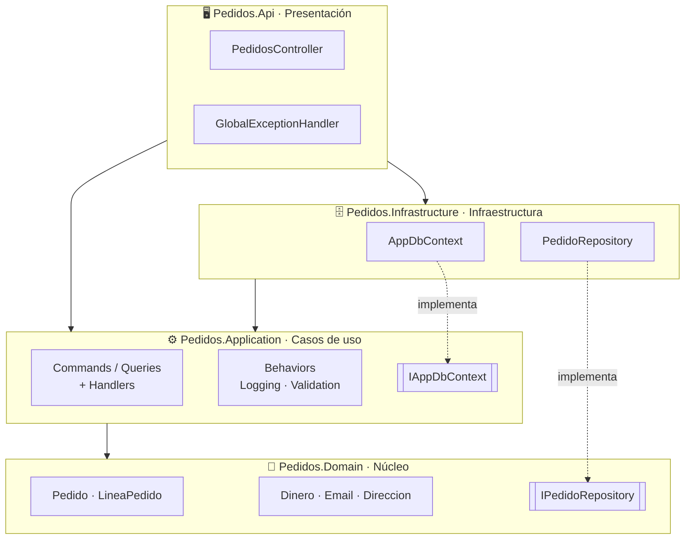
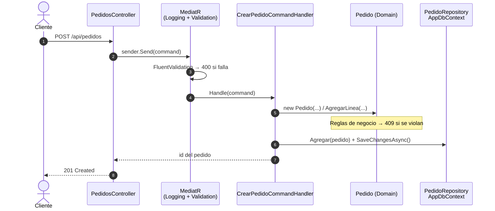

# PedidosSystem — Servicio Pedidos

Proyecto transversal de la **Certificación 2: Desarrollo Avanzado de Microservicios con C# y .NET** (LT Tech).

Backend del servicio **Pedidos** construido con **Clean Architecture**, **CQRS con MediatR** y **EF Core** sobre **.NET 10**, documentado con **Swagger**.

---

## Arquitectura limpia

La regla principal: **las dependencias siempre apuntan hacia el centro**. El dominio no conoce a nadie; las capas de afuera conocen a las de adentro.

```
┌─────────────────────────────────────────────────────────────────┐
│  Pedidos.Api                    Pedidos.Infrastructure          │
│  (controlador, errores,         (EF Core: DbContext,            │
│   Swagger)                       repositorio, migraciones)      │
│   ┌─────────────────────────────────────────────────────────┐   │
│   │  Pedidos.Application                                    │   │
│   │  (comandos, consultas, handlers, validadores,           │   │
│   │   behaviors, interfaces)                                │   │
│   │   ┌─────────────────────────────────────────────────┐   │   │
│   │   │  Pedidos.Domain                                 │   │   │
│   │   │  (Pedido, LineaPedido, Dinero, Email,           │   │   │
│   │   │   Direccion, reglas de negocio)                 │   │   │
│   │   └─────────────────────────────────────────────────┘   │   │
│   └─────────────────────────────────────────────────────────┘   │
└─────────────────────────────────────────────────────────────────┘
                 Las dependencias van de afuera hacia adentro ──►
```

### Capas y dependencias



> Las cajas con doble borde son **interfaces**. Se definen adentro (Application o Domain) y se implementan afuera o al costado: así el centro no depende de EF Core ni de ningún detalle técnico.

| Proyecto | Responsabilidad | Depende de |
|---|---|---|
| `Pedidos.Domain` | Entidades con sus reglas, objetos de valor, interfaz del repositorio | — |
| `Pedidos.Application` | Casos de uso (CQRS), validación, behaviors, interfaces que necesita | Domain |
| `Pedidos.Infrastructure` | Implementación con EF Core y SQL Server | Application |
| `Pedidos.Api` | Entrada HTTP, manejo de errores, documentación | Application, Infrastructure |

---

## Flujo de un request



**Paso a paso:**

1. **`PedidosController`** recibe el HTTP y llama a `sender.Send(...)`. No tiene lógica.
2. **MediatR** pasa el request por los **behaviors**: `LoggingBehavior` mide el tiempo y `ValidationBehavior` ejecuta los validadores de FluentValidation.
3. El **handler** orquesta el caso de uso.
4. El **dominio** (`Pedido`) aplica las reglas de negocio.
5. El handler guarda a través de las **interfaces**, que Infrastructure implementa con EF Core.

### Manejo de errores

Los errores viajan como **excepciones** y un único [`GlobalExceptionHandler`](src/Pedidos.Api/Infrastructure/GlobalExceptionHandler.cs) los convierte en respuestas `ProblemDetails`:

| Excepción | Dónde se lanza | HTTP |
|---|---|---|
| `ValidationException` | Validadores (FluentValidation) | 400 Bad Request |
| `NotFoundException` | Handlers: el pedido no existe | 404 Not Found |
| `ReglaNegocioException` | Dominio: se violó una regla | 409 Conflict |
| Cualquier otra | — | 500 (sin detalles internos) |

---

## Estructura del código

```
PedidosSystem/
├── src/
│   ├── Pedidos.Domain/
│   │   ├── Common/            Entity, ReglaNegocioException
│   │   ├── Pedidos/           Pedido, LineaPedido, EstadoPedido, IPedidoRepository
│   │   └── ValueObjects/      Dinero, Email, Direccion
│   │
│   ├── Pedidos.Application/
│   │   ├── Behaviors/         LoggingBehavior, ValidationBehavior
│   │   ├── Exceptions/        NotFoundException
│   │   ├── Interfaces/        Common/IAppDbContext, y una carpeta por entidad
│   │   ├── Pedidos/
│   │   │   ├── Commands/      CrearPedido, ConfirmarPedido, CancelarPedido, CancelarBorradoresAntiguos
│   │   │   └── Queries/       ObtenerPedido (+ PedidoDto)
│   │   └── ApplicationServiceExtensions.cs      → AddApplication()
│   │
│   ├── Pedidos.Infrastructure/
│   │   ├── Persistence/
│   │   │   ├── MapeoEntidades/   mapeo de cada entidad a su tabla (Fluent API de EF Core)
│   │   │   ├── Migrations/
│   │   │   ├── Repositories/     PedidoRepository
│   │   │   └── AppDbContext.cs
│   │   └── InfrastructureServiceExtensions.cs   → AddInfrastructure()
│   │
│   └── Pedidos.Api/
│       ├── Controllers/       PedidosController, ProductosController
│       ├── Endpoints/         DemoClase4Endpoints (solo Development)
│       ├── Infrastructure/    GlobalExceptionHandler
│       └── Program.cs
│
└── tests/
    ├── Pedidos.Domain.Tests/        reglas del dominio y objetos de valor
    └── Pedidos.Application.Tests/   handlers, validadores y reglas de CQRS (con fakes)
```

Cada interfaz se conecta con su implementación en un solo lugar:

| Interfaz | Implementación | Registrada en |
|---|---|---|
| `IPedidoRepository` · `IProductoRepository` | `PedidoRepository` · `ProductoRepository` | [InfrastructureServiceExtensions.cs](src/Pedidos.Infrastructure/InfrastructureServiceExtensions.cs) |
| `IPedidosConsultas` · `IProductoConsultas` | `PedidosConsultas` · `ProductosConsultas` (EF Core) | [InfrastructureServiceExtensions.cs](src/Pedidos.Infrastructure/InfrastructureServiceExtensions.cs) |
| `IPedidosReportes` | `PedidosReportes` (Dapper puro, sin EF Core: un método con procedimiento almacenado y otro con SELECT + LINQ a objetos) | [InfrastructureServiceExtensions.cs](src/Pedidos.Infrastructure/InfrastructureServiceExtensions.cs) |
| `IDemoMalasPracticas` (solo Clase 4) | `DemoMalasPracticas` | [InfrastructureServiceExtensions.cs](src/Pedidos.Infrastructure/InfrastructureServiceExtensions.cs) |
| `IAppDbContext` | `AppDbContext` | [InfrastructureServiceExtensions.cs](src/Pedidos.Infrastructure/InfrastructureServiceExtensions.cs) |

---

## Decisiones de diseño

- **El controlador no tiene lógica:** solo envía el request por MediatR y devuelve la respuesta.
- **Validación en dos niveles:** FluentValidation revisa la *forma* de los datos (campos obligatorios, formatos); el dominio protege las *reglas de negocio* (solo se confirma un borrador, la cantidad es positiva).
- **Behaviors = decoradores:** `LoggingBehavior` y `ValidationBehavior` envuelven a todos los handlers sin modificarlos (patrón Decorator, Clase 2).
- **CQRS:** todo mensaje es un `ICommand` (cambia estado) o un `IQuery` (solo lee). Los comandos pasan por su `IXRepository` (reglas de negocio y persistencia, con tracking); las consultas pasan por su `IXConsultas`, que proyecta directo al DTO con `AsNoTracking`. Ninguna consulta usa un repositorio de escritura ni ningún comando usa consultas: lo verifican los tests de `CqrsArquitecturaTests`. Mismo modelo y misma base (`AppDbContext`).
- **DTOs sin lógica:** `PedidoDto` y los demás solo transportan datos; los arma la proyección de la consulta, no un mapper.
- **Un solo contexto con nombre genérico:** `AppDbContext` (interfaz `IAppDbContext`) agrupa Pedidos y Productos en una sola base; no se llama como una entidad para no confundirse, y no es una `IUnitOfWork` genérica.
- **MediatR 12.5.0:** última versión con licencia Apache 2.0 (desde la 13 requiere clave de licencia).
- **Para más adelante:** eventos de dominio (Día 3, cápsula 3.6).

---

## Clientes (otro servicio)

Clientes es **otro dominio, otra API y otra base** (proyecto hermano **ClientesSystem**, base `ClientesDb`); solo allí se hace el CRUD. Pedidos guarda `ClienteId` y `EmailCliente` como un **campo** del pedido (sin clave foránea) y, cuando necesita los datos del cliente, los **consulta al momento por REST** (`GET`) desde Infrastructure (`Rest/Clientes`) con `IClienteConsultas`; Application no sabe que hay HTTP detrás. La URL se configura en `Servicios:Clientes` (`https://localhost:7201/`). Hay que arrancar antes ClientesSystem; si no responde, Pedidos devuelve **503**.

## Requisitos

- [.NET 10 SDK](https://dot.net)
- SQL Server **LocalDB** (viene con Visual Studio)
- Herramienta de EF Core: `dotnet tool install --global dotnet-ef`

## Cómo correrlo

```bash
# 1. Crear la base de datos (LocalDB; la cadena está en appsettings.Development.json)
dotnet ef database update --project src/Pedidos.Infrastructure --startup-project src/Pedidos.Api

# 2. Compilar y correr los tests
dotnet build
dotnet test

# 3. Ejecutar la API → Swagger en https://localhost:7101/swagger
dotnet run --project src/Pedidos.Api --launch-profile https
```

> **Advertencia de certificado en el navegador:** ejecutar una vez `dotnet dev-certs https --trust`.

## Endpoints

| Método | Ruta | Caso de uso | Respuestas |
|---|---|---|---|
| POST | `/api/pedidos` | `CrearPedidoCommand` | 201, 400, 409 |
| GET | `/api/pedidos/{id}` | `ObtenerPedidoQuery` | 200, 404 |
| GET | `/api/pedidos/{id}/cliente` | `ObtenerClienteDePedidoQuery`: lee el `ClienteId` del pedido y pide los datos al servicio Clientes por REST | 200, 404, 503 |
| GET · GET | `/api/clientes`, `/api/clientes/{id}` | `ListarClientesQuery` / `ObtenerClienteQuery`: **solo lectura**, consulta al servicio Clientes por REST (el CRUD está en ClientesSystem) | 200, 400, 404, 503 |
| POST | `/api/pedidos/{id}/confirmar` | `ConfirmarPedidoCommand` | 204, 404, 409 |
| POST | `/api/pedidos/{id}/cancelar` | `CancelarPedidoCommand` | 204, 404, 409 |
| POST | `/api/pedidos/cancelar-borradores-antiguos?dias=30` | `CancelarBorradoresAntiguosCommand`: procedimiento `CancelarBorradoresAntiguos` ejecutado con Dapper | 200, 400 |
| GET | `/api/auditoria?ruta=&desde=&hasta=` | `ListarAuditoriaQuery`: operaciones POST/PUT/DELETE guardadas por `AuditoriaMiddleware` (tabla `Auditoria`, script `scripts/auditoria.sql`) | 200, 400 |
| POST · GET · GET · PUT · DELETE | `/api/productos`, `/api/productos/{id}` | Crear / Listar (`categoria`, `precioMinimo`) / Obtener / Actualizar / Eliminar producto | 2xx, 400, 404, 409 |

### Demos de la Clase 4 (solo Development)

Scripts (ejecutar en este orden sobre `PedidosDb`): `scripts/procedimientos-clase4.sql` (procedimientos `ActualizarStock`, `CancelarBorradoresAntiguos` y `ObtenerVentasPorDia`) y `scripts/seed-clase4.sql` (50.000 productos, 100 clientes, 1.000 pedidos; los clientes del seed ya no los usa ninguna API de Pedidos). Para probar Dapper en clase hay un grupo **Dapper** en Swagger: `GET /demo/clase4/ventas-por-dia` (ejecuta juntos los dos métodos de Dapper, sin EF Core: procedimiento almacenado y SELECT + LINQ a objetos) y `POST /demo/clase4/dapper/cancelar-borradores-antiguos?dias=30` (este último modifica datos). Dapper se usa en Pedidos con procedimientos almacenados: `PedidosReportes` (lectura, `QueryAsync`, sin EF Core) y `PedidoRepository.CancelarBorradoresAntiguosAsync` (escritura, `ExecuteAsync` con parámetro de salida). Cada tema tiene su versión `malo` y `bueno` en `/demo/clase4/...` (`linq`, `pedidos`, `n1`, `sql`, `reporte`, `stock`, `productos/aumentar`, `transaccion`). Para ver el SQL de cada una, poner `Microsoft.EntityFrameworkCore.Database.Command` en `Information` en el appsettings. `/demo/clase4/sql/malo` es vulnerable a propósito.

### Ejemplo: crear un pedido

```json
{
  "clienteId": "8c6f4a52-1b3e-4f0a-9a7d-2f1c3e5b7d90",
  "emailCliente": "ana@ejemplo.com",
  "direccion": {
    "calle": "Calle 100 # 15-20",
    "ciudad": "Bogotá",
    "codigoPostal": "110111",
    "pais": "Colombia"
  },
  "moneda": "COP",
  "lineas": [
    { "productoId": "0f8fad5b-d9cb-469f-a165-70867728950e", "nombreProducto": "Teclado", "precioUnitario": 150000, "cantidad": 2 },
    { "productoId": "7c9e6679-7425-40de-944b-e07fc1f90ae7", "nombreProducto": "Mouse", "precioUnitario": 60000, "cantidad": 1 }
  ]
}
```

Para probarlo: en Swagger, abrir `POST /api/pedidos` → **Try it out**, pegar este JSON y ejecutar. Devuelve `201` con el `id`, que se usa en los demás endpoints.
