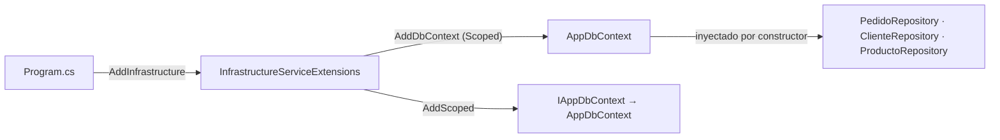
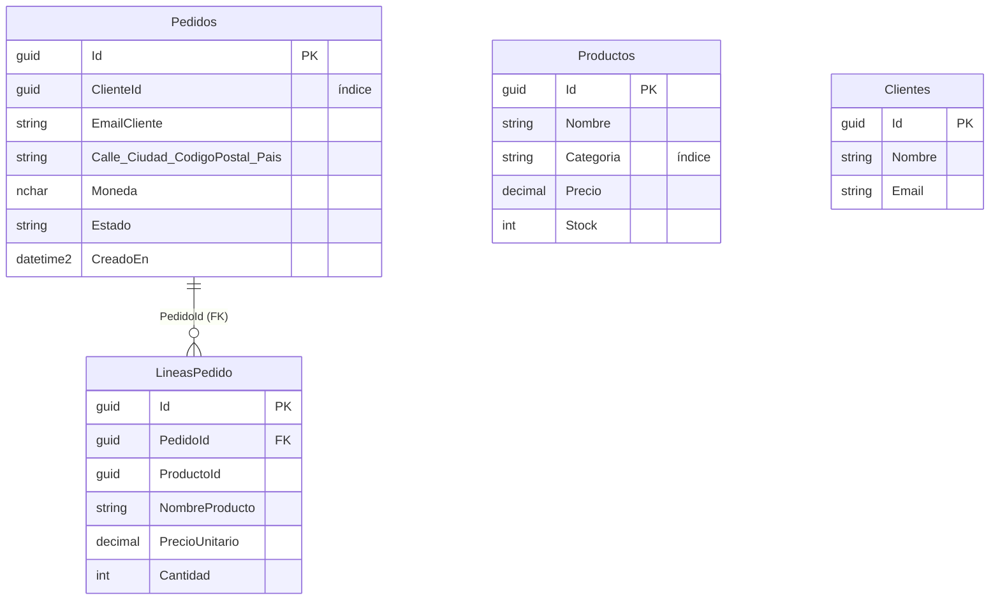
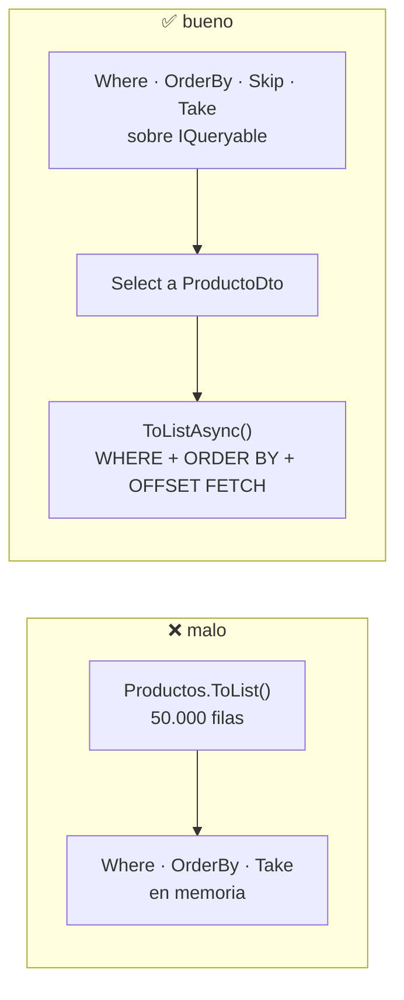
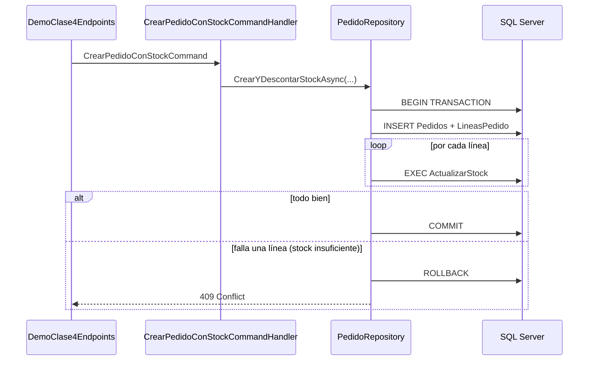
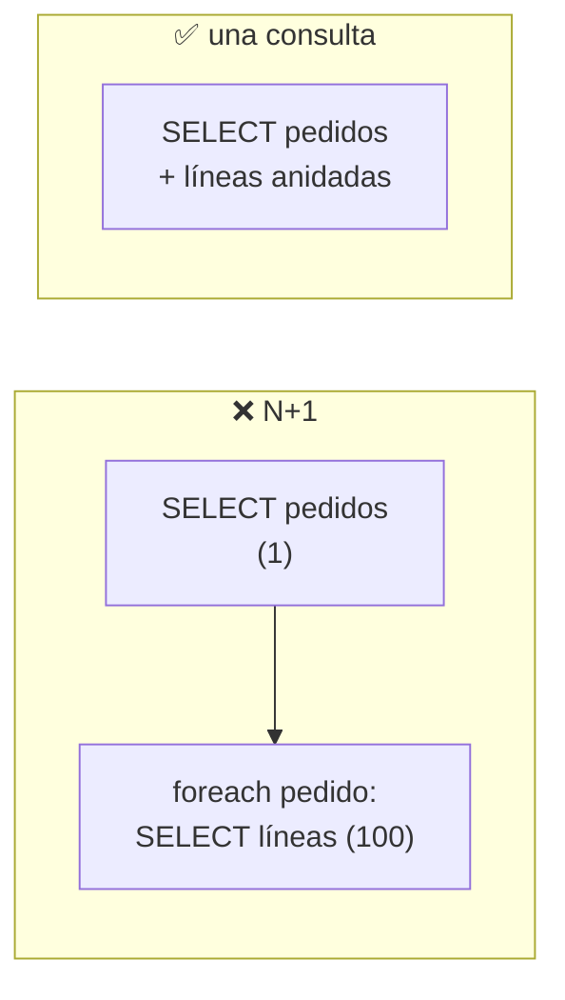
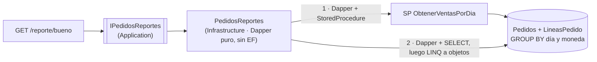
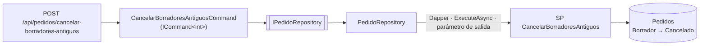

# Clase 4 · Mapa de la solución

Dónde está cada punto de la Clase 4 (EF Core, LINQ, Dapper y transacciones) dentro del proyecto **Pedidos**, con las carpetas y las clases involucradas. Se recorre en el mismo orden que `INSTRUCCIONES-clase4.md`.

> Los endpoints de demo viven en `/demo/clase4/...` y solo se mapean en **Development**.
> Datos de prueba: [`scripts/procedimientos-clase4.sql`](../scripts/procedimientos-clase4.sql) y luego [`scripts/seed-clase4.sql`](../scripts/seed-clase4.sql).

---

## 4.1 · DbContext e inyección de dependencias

**Qué se muestra:** el `DbContext` llega por constructor y se registra **Scoped** con `AddDbContext`. Domain no referencia a EF Core.

| Qué | Dónde |
|---|---|
| DbContext con los `DbSet` | [`AppDbContext.cs`](../src/Pedidos.Infrastructure/Persistence/AppDbContext.cs) |
| Interfaz de unidad de trabajo que implementa | [`IAppDbContext.cs`](../src/Pedidos.Application/Interfaces/Common/IAppDbContext.cs) |
| Registro (`AddDbContext`, repositorios, consultas) | [`InfrastructureServiceExtensions.cs`](../src/Pedidos.Infrastructure/InfrastructureServiceExtensions.cs) |
| Llamada al registro | [`Program.cs`](../src/Pedidos.Api/Program.cs) → `AddInfrastructure(...)` |
| Cadena de conexión | `src/Pedidos.Api/appsettings.Development.json` → `ConnectionStrings:Pedidos` |
| Entidades (solo datos, sin EF) | [`Domain/`](../src/Pedidos.Domain) → `Pedidos/`, `Clientes/`, `Productos/` |

```
Pedidos.Domain/                      ← sin referencias a EF Core
├── Pedidos/    Pedido · LineaPedido · EstadoPedido
├── Clientes/   Cliente
├── Productos/  Producto
└── ValueObjects/  Dinero · Email · Direccion

Pedidos.Infrastructure/
├── Persistence/AppDbContext.cs  ← DbSet: Pedidos · Productos · Clientes · LineasPedido
└── InfrastructureServiceExtensions.cs  ← AddDbContext (Scoped)
```



> `LineasPedido` aparece como `DbSet` propio **solo** para mostrar el problema N+1 (4.5).

---

## 4.2 · Mapeo con Fluent API

**Qué se muestra:** cómo cada entidad se mapea a su tabla (nombres, claves, largos, precisión, índices, relaciones) sin ensuciar el dominio con atributos.

| Entidad | Clase de mapeo |
|---|---|
| `Pedido` (+ `Email` y `Direccion` como *owned types*, índice por `ClienteId`) | [`PedidoMapeo.cs`](../src/Pedidos.Infrastructure/Persistence/MapeoEntidades/Pedidos/PedidoMapeo.cs) |
| `LineaPedido` (+ `Dinero` como *owned type*) | [`LineaPedidoMapeo.cs`](../src/Pedidos.Infrastructure/Persistence/MapeoEntidades/Pedidos/LineaPedidoMapeo.cs) |
| `Cliente` | [`ClienteMapeo.cs`](../src/Pedidos.Infrastructure/Persistence/MapeoEntidades/Clientes/ClienteMapeo.cs) |
| `Producto` (índice por `Categoria`) | [`ProductoMapeo.cs`](../src/Pedidos.Infrastructure/Persistence/MapeoEntidades/Productos/ProductoMapeo.cs) |

```
Pedidos.Infrastructure/Persistence/
├── AppDbContext.cs      ← ApplyConfigurationsFromAssembly(...)
└── MapeoEntidades/
    ├── Pedidos/     PedidoMapeo · LineaPedidoMapeo
    ├── Clientes/    ClienteMapeo
    └── Productos/   ProductoMapeo
```

**Tablas en `PedidosDb`**



**Datos de prueba:** [`seed-clase4.sql`](../scripts/seed-clase4.sql) carga 50.000 productos, 100 clientes y 1.000 pedidos con 3 líneas cada uno.

> Las migraciones de EF Core se eliminaron: hoy el esquema de la base existe, pero no hay migraciones que lo recreen.

---

## 4.3 · LINQ con EF Core

**Qué se muestra:** ejecutar al final (`ToList` tarde) frente a `ToList` temprano. El SQL buen o malo se ve en la consola.

| Endpoint | Versión | Clase y método |
|---|---|---|
| `GET /demo/clase4/linq/malo` | Mala | [`DemoMalasPracticas.ProductosFiltradosEnMemoriaAsync`](../src/Pedidos.Infrastructure/Demo/DemoMalasPracticas.cs) |
| `GET /demo/clase4/linq/bueno?pagina=1` | Buena | [`ListarProductosQuery`](../src/Pedidos.Application/Productos/Queries/ListarProductos/ListarProductosQuery.cs) → [`ProductosConsultas.ListarAsync`](../src/Pedidos.Infrastructure/Queries/Productos/ProductosConsultas.cs) |
| `GET /demo/clase4/linq/sql` | Muestra el SQL | `ProductosConsultas.ObtenerSqlListado` (`ToQueryString`) |



```
Application/Interfaces/Productos/IProductoConsultas.cs     ← contrato
Application/Productos/Queries/ListarProductos/             ← caso de uso (MediatR)
Infrastructure/Queries/Productos/ProductosConsultas.cs     ← EF Core: filtra, ordena y pagina en la base
Infrastructure/Demo/DemoMalasPracticas.cs                  ← la versión mala
Api/Endpoints/DemoClase4Endpoints.cs                       ← MapLinq(...)
```

---

## 4.4 · Consultas, actualizaciones y transacciones

### a) Proyecciones y `AsNoTracking`

| Endpoint | Versión | Clase y método |
|---|---|---|
| `GET /demo/clase4/pedidos/malo/{clienteId}` | Mala (entidad completa, con tracking) | `DemoMalasPracticas.PedidosDelClienteComoEntidadAsync` |
| `GET /demo/clase4/pedidos/bueno/{clienteId}` | Buena (`AsNoTracking` + DTO) | [`ListarPedidosQuery`](../src/Pedidos.Application/Pedidos/Queries/ListarPedidos/ListarPedidosQuery.cs) → [`PedidosConsultas.ListarAsync`](../src/Pedidos.Infrastructure/Queries/Pedidos/PedidosConsultas.cs) |

### b) Actualización masiva con `ExecuteUpdate`

| Endpoint | Clase y método |
|---|---|
| `POST /demo/clase4/productos/aumentar/{categoria}` | [`AumentarPrecioCategoriaCommand`](../src/Pedidos.Application/Productos/Commands/AumentarPrecioCategoria/AumentarPrecioCategoriaCommand.cs) → [`ProductoRepository.AumentarPrecioPorCategoriaAsync`](../src/Pedidos.Infrastructure/Persistence/Repositories/Productos/ProductoRepository.cs) |

Un solo `UPDATE ... WHERE Categoria = ...`, sin `SELECT` previo.

### c) Confirmar un pedido (un solo `UPDATE`)

| Qué | Dónde |
|---|---|
| Caso de uso | [`ConfirmarPedidoCommand.cs`](../src/Pedidos.Application/Pedidos/Commands/ConfirmarPedido/ConfirmarPedidoCommand.cs) |
| Reglas de negocio y `SaveChanges` | [`PedidoRepository.ConfirmarAsync`](../src/Pedidos.Infrastructure/Persistence/Repositories/Pedidos/PedidoRepository.cs) |
| Endpoint real | `POST /api/pedidos/{id}/confirmar` en [`PedidosController`](../src/Pedidos.Api/Controllers/PedidosController.cs) |

### d) Transacciones: pedido con sus líneas + descuento de stock

| Endpoint | Resultado si falla la línea 3 |
|---|---|
| `POST /demo/clase4/transaccion/malo` | ❌ Queda el pedido y el stock de las líneas 1 y 2 descontado |
| `POST /demo/clase4/transaccion/bueno` | ✅ Rollback: no queda nada |



| Qué | Dónde |
|---|---|
| Contrato | [`IPedidoRepository.CrearYDescontarStockAsync`](../src/Pedidos.Application/Interfaces/Pedidos/IPedidoRepository.cs) |
| Caso de uso | [`CrearPedidoConStockCommand.cs`](../src/Pedidos.Application/Pedidos/Commands/CrearPedidoConStock/CrearPedidoConStockCommand.cs) |
| **La transacción** (`BeginTransactionAsync`, `Commit`, `Rollback`) | [`PedidoRepository.CrearYDescontarStockAsync`](../src/Pedidos.Infrastructure/Persistence/Repositories/Pedidos/PedidoRepository.cs) |
| Versión mala (sin transacción) | [`DemoMalasPracticas.CrearPedidoYDescontarStockSinTransaccionAsync`](../src/Pedidos.Infrastructure/Demo/DemoMalasPracticas.cs) |
| Conversión del comando (compartida) | [`CrearPedidoCommandExtensions.cs`](../src/Pedidos.Application/Pedidos/Commands/CrearPedido/CrearPedidoCommandExtensions.cs) |

---

## 4.5 · Rendimiento y SQL directo

### a) El problema N+1

| Endpoint | Versión | Consultas | Clase y método |
|---|---|---|---|
| `GET /demo/clase4/n1/malo` | Mala | 101 | `DemoMalasPracticas.PedidosConLineasN1Async` |
| `GET /demo/clase4/n1/bueno` | Buena | 1 | [`PedidosConsultas.ListarConLineasAsync`](../src/Pedidos.Infrastructure/Queries/Pedidos/PedidosConsultas.cs) |



### b) SQL directo: inyección frente a parámetros

| Endpoint | Versión | Clase y método |
|---|---|---|
| `GET /demo/clase4/sql/malo?nombre=' OR '1'='1` | ❌ Concatena el valor: devuelve todo | `DemoMalasPracticas.ProductosPorNombreInyectableAsync` (`FromSqlRaw`) |
| `GET /demo/clase4/sql/bueno?nombre=...` | ✅ Parámetro `@p0`: no devuelve nada | [`ProductosConsultas.BuscarPorNombreAsync`](../src/Pedidos.Infrastructure/Queries/Productos/ProductosConsultas.cs) (`FromSql`) |

> `/sql/malo` es **vulnerable a propósito**. Solo en Development y solo para la clase. Las reglas de Sonar/EF que lo marcan (S2077, EF1002, EF1003) se desactivan únicamente en `DemoMalasPracticas`.

### c) Procedimiento almacenado con EF Core

| Qué | Dónde |
|---|---|
| El procedimiento `ActualizarStock` | [`scripts/procedimientos-clase4.sql`](../scripts/procedimientos-clase4.sql) |
| Llamada (`ExecuteSqlAsync` con interpolación segura) | [`ProductoRepository.DescontarStockAsync`](../src/Pedidos.Infrastructure/Persistence/Repositories/Productos/ProductoRepository.cs) |
| Caso de uso | [`DescontarStockCommand.cs`](../src/Pedidos.Application/Productos/Commands/DescontarStock/DescontarStockCommand.cs) |
| Endpoint | `POST /demo/clase4/stock/{productoId}/{cantidad}` |

---

## 4.6 · Dapper y la capa de datos

**Qué se muestra:** Dapper llamando a un **procedimiento almacenado** para un reporte, detrás de una interfaz de Application. Además hay un segundo uso de Dapper para **escribir**: ejecutar un procedimiento con parámetro de salida (ver "Dapper ejecutando un procedimiento de escritura", más abajo).

| Endpoint | Versión | Clase y método |
|---|---|---|
| `GET /demo/clase4/reporte/malo` | ❌ Trae todos los pedidos con sus líneas y agrupa en memoria | `DemoMalasPracticas.VentasPorDiaEnMemoriaAsync` |
| `GET /demo/clase4/reporte/bueno?desde=2026-01-01&hasta=2027-01-01` | ✅ Dapper + procedimiento: la base agrupa | [`PedidosReportes.VentasPorDiaProcedimientoAsync`](../src/Pedidos.Infrastructure/Queries/Pedidos/PedidosReportes.cs) |
| `GET /demo/clase4/ventas-por-dia` | ⚖️ **Los dos métodos de Dapper juntos**, para compararlos | `PedidosReportes.VentasPorDiaProcedimientoAsync` y `VentasPorDiaLinqAsync` |

**La misma consulta, dos métodos, ninguno usa Entity Framework** (`GET /demo/clase4/ventas-por-dia`, `desde` y `hasta` opcionales; sin ellos, el último año):

| Método | Cómo lo resuelve | Filas que lee de la base |
|---|---|---|
| `VentasPorDiaProcedimientoAsync` | Dapper llama al procedimiento `ObtenerVentasPorDia`: la base agrupa | solo el resultado (72) |
| `VentasPorDiaLinqAsync` | Dapper trae las líneas con un `SELECT` parametrizado y **LINQ a objetos** agrupa y suma en memoria | todas las líneas (2.186) |

La respuesta indica si los dos resultados son idénticos (`iguales`), el tiempo de cada uno y cuántas filas leyó de la base: así se ve que el procedimiento mueve mucho menos datos.



| Qué | Dónde |
|---|---|
| Interfaz | [`IPedidosReportes.cs`](../src/Pedidos.Application/Interfaces/Pedidos/IPedidosReportes.cs) |
| DTO | [`VentaPorDiaDto.cs`](../src/Pedidos.Application/Pedidos/Queries/VentasPorDia/VentaPorDiaDto.cs) |
| Implementación con Dapper (sin EF Core; la conexión viene de [`ConexionSql`](../src/Pedidos.Infrastructure/Persistence/ConexionSql.cs)) | [`PedidosReportes.cs`](../src/Pedidos.Infrastructure/Queries/Pedidos/PedidosReportes.cs) |
| Procedimiento `ObtenerVentasPorDia` | [`scripts/procedimientos-clase4.sql`](../scripts/procedimientos-clase4.sql) |
| Paquete | `Dapper` en [`Directory.Packages.props`](../Directory.Packages.props) |

---

### Endpoints para probar Dapper en clase

Solo Development. En Swagger se agrupan todos bajo la etiqueta **Dapper**: `ventas-por-dia`, `reporte/bueno` (lectura, descritos arriba) y el POST de cancelar borradores (escritura):

| Endpoint | Técnica | Clase y método |
|---|---|---|
| `GET /demo/clase4/ventas-por-dia` | Los dos métodos de lectura de Dapper, juntos | [`PedidosReportes`](../src/Pedidos.Infrastructure/Queries/Pedidos/PedidosReportes.cs) |
| `POST /demo/clase4/dapper/cancelar-borradores-antiguos?dias=30` | `ExecuteAsync` + procedimiento `CancelarBorradoresAntiguos` con parámetro de salida | [`PedidoRepository.CancelarBorradoresAntiguosAsync`](../src/Pedidos.Infrastructure/Persistence/Repositories/Pedidos/PedidoRepository.cs) |

> El segundo **modifica datos**: pasa los pedidos en borrador con más de N días a "Cancelado". Para repetir la demo hay que volver a poner esos pedidos en "Borrador".

### Dapper ejecutando un procedimiento de escritura

`POST /api/pedidos/cancelar-borradores-antiguos?dias=30` cancela los pedidos en borrador con más de N días sin confirmarse. Es un **comando**, así que pasa por el repositorio (lado de escritura) y no por las consultas.



| Qué | Dónde |
|---|---|
| Comando, validador y handler | [`CancelarBorradoresAntiguosCommand.cs`](../src/Pedidos.Application/Pedidos/Commands/CancelarBorradoresAntiguos/CancelarBorradoresAntiguosCommand.cs) |
| Contrato | [`IPedidoRepository.CancelarBorradoresAntiguosAsync`](../src/Pedidos.Application/Interfaces/Pedidos/IPedidoRepository.cs) |
| Dapper (`DynamicParameters` con `ParameterDirection.Output`) | [`PedidoRepository.CancelarBorradoresAntiguosAsync`](../src/Pedidos.Infrastructure/Persistence/Repositories/Pedidos/PedidoRepository.cs) |
| Procedimiento `CancelarBorradoresAntiguos` | [`scripts/procedimientos-clase4.sql`](../scripts/procedimientos-clase4.sql) |

---

## Auditoría de POST, PUT y DELETE

El `AuditoriaMiddleware` (Transient, `IMiddleware`) guarda cada operación que modifica datos en la tabla `Auditoria`, incluido el cuerpo del request (JSON tal cual llega, recortado a 4.000 caracteres; puede contener datos personales).

| Qué | Dónde |
|---|---|
| Tabla (script) | [`scripts/auditoria.sql`](../scripts/auditoria.sql) |
| Entidad | [`RegistroAuditoria.cs`](../src/Pedidos.Domain/Auditoria/RegistroAuditoria.cs) |
| Middleware | [`AuditoriaMiddleware.cs`](../src/Pedidos.Api/Middleware/AuditoriaMiddleware.cs) |
| Interfaces | [`IAuditoriaRepository`](../src/Pedidos.Application/Interfaces/Auditoria/IAuditoriaRepository.cs) · [`IAuditoriaConsultas`](../src/Pedidos.Application/Interfaces/Auditoria/IAuditoriaConsultas.cs) |
| Implementación | [`AuditoriaRepository`](../src/Pedidos.Infrastructure/Persistence/Repositories/Auditoria/AuditoriaRepository.cs) · [`AuditoriaConsultas`](../src/Pedidos.Infrastructure/Queries/Auditoria/AuditoriaConsultas.cs) |
| Consulta | `GET /api/auditoria` en [`AuditoriaController`](../src/Pedidos.Api/Controllers/AuditoriaController.cs) |

---

## Resumen: todo en un vistazo

| Punto | Tema | Versión mala | Versión buena |
|---|---|---|---|
| 4.1 | DbContext + DI | — | `AppDbContext` Scoped |
| 4.2 | Fluent API | — | `MapeoEntidades/*` |
| 4.3 | LINQ | `ToList` temprano | `ProductosConsultas.ListarAsync` |
| 4.4 | Proyección | entidad + tracking | `PedidosConsultas.ListarAsync` |
| 4.4 | Actualización masiva | — | `ExecuteUpdate` en `ProductoRepository` |
| 4.4 | Transacciones | sin transacción | `BeginTransaction` en `PedidoRepository` |
| 4.5 | N+1 | 101 consultas | 1 consulta |
| 4.5 | SQL directo | concatenado | `FromSql` parametrizado |
| 4.5 | Procedimiento (EF Core) | — | `ActualizarStock` |
| 4.6 | Dapper | agrupar en memoria | procedimiento `ObtenerVentasPorDia` |

## Estructura completa de las carpetas relevantes

```
PedidosSystem/
├── scripts/
│   ├── procedimientos-clase4.sql      ActualizarStock · ObtenerVentasPorDia
│   └── seed-clase4.sql                datos de prueba
│
└── src/
    ├── Pedidos.Domain/                Pedido · LineaPedido · Cliente · Producto · value objects
    │
    ├── Pedidos.Application/
    │   ├── Common/                    PagedResult
    │   ├── Interfaces/
    │   │   ├── Common/                IAppDbContext
    │   │   ├── Pedidos/               IPedidoRepository · IPedidosConsultas · IPedidosReportes
    │   │   ├── Clientes/              IClienteRepository · IClienteConsultas
    │   │   ├── Productos/             IProductoRepository · IProductoConsultas
    │   │   └── Demo/                  IDemoMalasPracticas
    │   ├── Pedidos/                   Commands (Crear · CrearConStock · Actualizar · Eliminar · Confirmar · Cancelar)
    │   │                              Queries  (Obtener · Listar · VentasPorDia)
    │   ├── Clientes/                  Commands (Crear · Actualizar · Eliminar) · Queries (Obtener · Listar)
    │   └── Productos/                 Commands (Crear · Actualizar · Eliminar · AumentarPrecioCategoria · DescontarStock)
    │                                  Queries  (Obtener · Listar)
    │
    ├── Pedidos.Infrastructure/
    │   ├── Persistence/
    │   │   ├── AppDbContext.cs
    │   │   ├── MapeoEntidades/        PedidoMapeo · LineaPedidoMapeo · ClienteMapeo · ProductoMapeo
    │   │   └── Repositories/          PedidoRepository · ClienteRepository · ProductoRepository
    │   ├── Queries/                   PedidosConsultas (EF Core) · PedidosReportes (Dapper) · ClientesConsultas · ProductosConsultas
    │   ├── Demo/                      DemoMalasPracticas
    │   └── InfrastructureServiceExtensions.cs
    │
    └── Pedidos.Api/
        ├── Controllers/               PedidosController · ClientesController · ProductosController
        ├── Endpoints/                 DemoClase4Endpoints
        └── Program.cs
```
