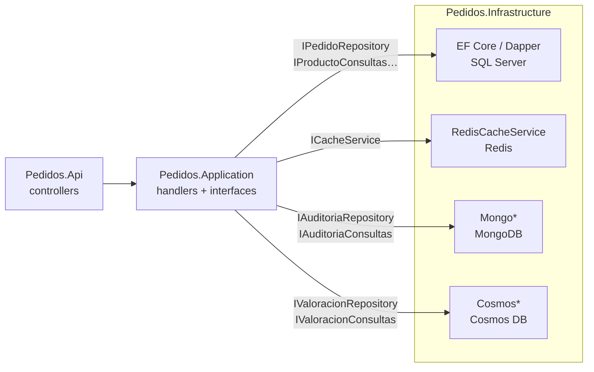

# Clase 5 · Bases de datos del proyecto

Detalle de cada base de datos que usa el proyecto **Pedidos**: para qué sirve, dónde está en el código, cómo se levanta, cómo se ve y qué endpoints la usan. Complementa a [`INSTRUCCIONES-clase5.md`](../INSTRUCCIONES-clase5.md) y al plan de la clase (`dia5/plan.md`).

> **Configuración detallada de cada tecnología** (Docker, cadenas de conexión, paquetes, problemas frecuentes): [`docs/tecnologias/`](tecnologias/README.md).

> **Regla de arquitectura:** toda tecnología de almacenamiento vive en **Pedidos.Infrastructure**. Application solo define interfaces (`ICacheService`, `IAuditoriaRepository`, `IValoracionRepository`…) y Domain no referencia a ninguna base. Cambiar de tecnología es cambiar una línea en [`InfrastructureServiceExtensions.cs`](../src/Pedidos.Infrastructure/InfrastructureServiceExtensions.cs).

---

## Resumen

| Base | Para qué se usa | Puerto | Estado respecto a las instrucciones |
|---|---|---|---|
| **SQL Server** (LocalDB) | Pedidos, líneas, productos y clientes (transaccional) | LocalDB | Clase 4, sin cambios |
| **Redis** | Caché de productos y de pedidos por fechas (cache-aside) + demo malo/bueno | 6379 · Insight 5540 | Tarea 5.2 completa |
| **MongoDB** | Auditoría de POST, PUT y DELETE | 27017 · Mongo Express 8081 | **Extra**: no está en la Clase 5 |
| **Cosmos DB** (emulador) | Catálogo (SDK y EF Core) y valoraciones | 8083 · Explorer 1234 | Tareas 5.4, 5.5 y 5.6 completas |
| **Blob Storage** (Azurite) | Imágenes de productos | 10000 | Tarea 5.3 completa |

## Cómo levantar todo

```powershell
docker compose up -d        # Redis, Redis Insight, MongoDB, Mongo Express, Azurite y Cosmos
```

Hay un único `docker-compose.yml` (las instrucciones hablan de `docker-compose.clase5.yml`; se unificó para no repetir puertos ni contenedores).

SQL Server se crea con [`scripts/crear-base-de-datos.sql`](../scripts/crear-base-de-datos.sql) y se llena con [`scripts/seed-clase4.sql`](../scripts/seed-clase4.sql).

| Servicio | Dirección | Interfaz para verlo |
|---|---|---|
| API (Swagger) | `https://localhost:7101/swagger` | – |
| Redis Insight | `http://localhost:5540` | conexión: host `redis`, puerto `6379` |
| Mongo Express | `http://localhost:8081` | base `PedidosDb` → colección `auditoria` |
| Cosmos Data Explorer | `http://localhost:1234` | base `PedidosDb` → contenedor `valoraciones` |

Las cadenas de conexión están en [`appsettings.Development.json`](../src/Pedidos.Api/appsettings.Development.json) (`ConnectionStrings:Pedidos`, `Redis`, `Mongo`, `Cosmos`).

## Cómo se conecta cada una



---

## 1 · SQL Server (LocalDB)

**Rol:** datos transaccionales. Pedidos sigue aquí porque el pedido, sus líneas y el descuento de stock deben guardarse juntos.

| Dato | Detalle |
|---|---|
| Base | `PedidosDb` en `(localdb)\MSSQLLocalDB` |
| Tablas | `Clientes`, `Productos`, `Pedidos`, `LineasPedido` (FK con borrado en cascada) y `Auditoria` |
| Procedimiento | `ActualizarStock(@ProductoId, @Cantidad)`: descuenta stock solo si alcanza |
| Acceso | EF Core (escritura y proyecciones) y Dapper (reportes) |
| Código | [`Persistence/`](../src/Pedidos.Infrastructure/Persistence) y [`Queries/`](../src/Pedidos.Infrastructure/Queries) |
| Creación | [`scripts/crear-base-de-datos.sql`](../scripts/crear-base-de-datos.sql) (idempotente) |

> La tabla `Auditoria` **ya no recibe datos**: la auditoría se guarda en MongoDB. Las clases SQL (`AuditoriaRepository`, `AuditoriaConsultas`) siguen en el código sin registrarse, para poder comparar.

---

## 2 · Redis (caché)

**Rol:** acelerar lecturas con **cache-aside**: buscar en Redis; si no está, ir a SQL y guardar el resultado con expiración.

| Dato | Detalle |
|---|---|
| Imagen | `redis:7-alpine` (puerto 6379) y `redis/redisinsight` (5540) |
| Interfaz | [`ICacheService`](../src/Pedidos.Application/Interfaces/Common/ICacheService.cs) (Application) |
| Implementación | [`RedisCacheService`](../src/Pedidos.Infrastructure/Caching/RedisCacheService.cs) sobre `IDistributedCache` |
| Claves | Definidas en [`ClavesCache.cs`](../src/Pedidos.Application/Common/ClavesCache.cs) |
| Expiración | 5 minutos |
| Si Redis cae | Registra una advertencia y la consulta sigue en SQL (probado: responde 200, más lento por el timeout) |

**Endpoints**

| Método | Ruta | Qué hace |
|---|---|---|
| GET | `/api/cache/productos/{id}` | Devuelve el producto con `origen` (`sql` o `redis`) y los milisegundos |
| DELETE | `/api/cache/productos/{id}` | Invalida la clave |
| GET | `/api/cache/pedidos?desde=2026-09-15&hasta=2026-10-14` | Pedidos con sus líneas en ese rango (máximo 31 días y 200 pedidos) |
| DELETE | `/api/cache/pedidos?desde=…&hasta=…` | Invalida ese rango |

**Claves**

```
pedidos:v1:producto:{id}
pedidos:v1:pedidos-por-fechas:{yyyyMMdd}:{yyyyMMdd}
```

La clave es un texto armado con los parámetros: **no es un hash**. Un rango distinto genera otra clave y vuelve a SQL; Redis no reutiliza rangos parecidos.

**Demo "malo contra bueno"** (solo Development, tarea 5.2): usa `IDistributedCache` directo y claves con prefijo `demo:`.

| Método | Ruta | Qué muestra |
|---|---|---|
| GET | `/demo/clase5/cache/malo/{id}` | Guarda **sin expiración** (`TTL` = -1) |
| PUT | `/demo/clase5/cache/malo/{id}/precio/{precio}` | Cambia el precio y **no invalida**: la caché sigue con el dato viejo |
| GET | `/demo/clase5/cache/bueno/{id}` | Cache-aside con expiración de 10 min (`TTL` positivo) |
| PUT | `/demo/clase5/cache/bueno/{id}/precio/{precio}` | Cambia el precio e **invalida** la clave |

Ver las claves: `docker exec -it pedidossystem-redis-1 redis-cli KEYS "demo:*"` y `TTL demo:bueno:producto:{id}`.

**Para mostrar en clase**
- Llamar dos veces a `GET /api/cache/productos/{id}`: la primera `sql`, la segunda `redis`.
- Ver la clave: `docker exec -it pedidossystem-redis-1 redis-cli KEYS "pedidos:*"` y `TTL <clave>`.
- `DELETE` y volver a leer: otra vez `sql`.

**Límites conocidos:** el `PUT`/`DELETE` de `/api/productos` **no invalida** el caché; un dato editado puede verse viejo hasta 5 minutos. Redis no se entera de los cambios en SQL.

---

## 3 · MongoDB (auditoría)

**Rol:** guardar quién hizo qué en cada POST, PUT y DELETE. Son registros que solo se insertan, con el cuerpo del request en JSON.

| Dato | Detalle |
|---|---|
| Imagen | `mongo:7` (puerto 27017, volumen `mongo-data`) y `mongo-express` (8081) |
| Base / colección | `PedidosDb` / `auditoria` |
| Paquete | `MongoDB.Driver` 3.11.2 |
| Documento | [`AuditoriaDocumento`](../src/Pedidos.Infrastructure/Mongo/AuditoriaDocumento.cs) (`Id`, `FechaUtc`, `Metodo`, `Ruta`, `EstadoHttp`, `DuracionMs`, `Usuario`, `TraceId`, `Request`) |
| Índices | `FechaUtc` (descendente) y `Ruta`; se crean al arrancar |
| Escritura | [`AuditoriaMongoRepository`](../src/Pedidos.Infrastructure/Mongo/AuditoriaMongoRepository.cs) implementa `IAuditoriaRepository` |
| Lectura | [`AuditoriaMongoConsultas`](../src/Pedidos.Infrastructure/Mongo/AuditoriaMongoConsultas.cs) implementa `IAuditoriaConsultas` |
| Quién la usa | [`AuditoriaMiddleware`](../src/Pedidos.Api/Middleware/AuditoriaMiddleware.cs) y `GET /api/auditoria` |

Si MongoDB no responde, falla en 2 segundos (no en 30) y el middleware ignora el error: la auditoría nunca rompe la respuesta al cliente.

**Para mostrar en clase**
- Hacer un POST, PUT o DELETE en Swagger y abrir Mongo Express (`http://localhost:8081`).
- Por consola: `docker exec pedidossystem-mongo-1 mongosh --quiet PedidosDb --eval "db.auditoria.find().sort({FechaUtc:-1}).limit(5)"`.

**Notas:** los registros viejos que estuvieran en la tabla SQL **no se migraron**. Con `http://localhost:5101` cada operación se audita dos veces, porque la redirección a HTTPS (código 307) también pasa por el middleware; con `https://localhost:7101` no ocurre.

---

## 4 · Cosmos DB (emulador)

**Rol:** base de documentos. Guarda el **catálogo** (tareas 5.4 a 5.6, particionado por categoría) y las **valoraciones de productos** (particionadas por producto).

### Catálogo (`ProductoCatalogo`)

| Dato | Detalle |
|---|---|
| Entidad | [`ProductoCatalogo`](../src/Pedidos.Domain/Catalogo/ProductoCatalogo.cs) en Domain, solo datos; `Atributos` es un diccionario distinto por categoría |
| Contenedores | `Productos` (SDK, partition key `/categoria`) y `ProductosEf` (EF Core); se crean al arrancar en Development |
| Cliente | Un `CosmosClient` **Singleton** ([`CosmosOpciones`](../src/Pedidos.Infrastructure/Cosmos/CosmosOpciones.cs)) compartido por el SDK y las valoraciones |
| SDK | [`CatalogoRepository`](../src/Pedidos.Infrastructure/Cosmos/CatalogoRepository.cs) (`ICatalogoRepository`) y [`DemoCatalogo`](../src/Pedidos.Infrastructure/Cosmos/DemoCatalogo.cs) |
| EF Core | [`CatalogoDbContext`](../src/Pedidos.Infrastructure/Cosmos/CatalogoDbContext.cs) con `ToContainer`, `HasPartitionKey` y `UseCosmos` |

**Endpoints de demo** (`/demo/clase5`, solo Development)

| Método | Ruta | Qué muestra |
|---|---|---|
| POST | `/catalogo/seed` | Carga 300 productos con atributos distintos por categoría (repetible: reemplaza los mismos ids) |
| GET | `/catalogo/{categoria}/{id}` | **Point read** (id + partition key), con el costo en RU |
| GET | `/catalogo/bueno?categoria=` | Consulta con parámetros dentro de la partición |
| GET | `/catalogo/cruzada?nombre=` | Consulta sin partition key (cruza todas las particiones) |
| GET | `/catalogo/malo?categoria=` | **Insegura a propósito** (texto concatenado). Con `' OR '1'='1` devuelve los 300; la buena devuelve 0 |
| GET | `/catalogo/repositorio/{categoria}` | Lo mismo a través de `ICatalogoRepository` |
| POST | `/ef/seed` | EF Core: `AddRange` + un solo `SaveChanges` (30 documentos; cada llamada agrega 30 más) |
| GET | `/ef/{categoria}` | EF Core: LINQ con `WithPartitionKey` |

> `/catalogo/malo` es solo para la clase: no debe subirse a `main`.

**Para mostrar en clase:** en el Data Explorer, comparar un documento de `Productos` (SDK, propiedades en camelCase) con uno de `ProductosEf` (EF Core, con su propio formato y el campo de tipo). Límites de EF Core para Cosmos: sin migraciones (`EnsureCreated`), sin joins entre documentos, todo asíncrono y una consulta sin `WithPartitionKey` cruza particiones.

> **El costo en RU del emulador es siempre 1.** La documentación de Microsoft marca "Request Units" como *no implementado* en el emulador vNext. La diferencia real de costo entre el point read y la consulta cruzada solo se ve contra una cuenta de Azure.

### Valoraciones

**Rol:** demo mínima con clean architecture completa (comando, consulta, validador).

| Dato | Detalle |
|---|---|
| Imagen | `mcr.microsoft.com/cosmosdb/linux/azure-cosmos-emulator:vnext-latest` |
| Puertos | 8083 (API) y 1234 (Data Explorer) |
| Base / contenedor | `PedidosDb` / `valoraciones`, partition key **`/productoId`** (se crean solos la primera vez) |
| Paquetes | `Microsoft.Azure.Cosmos` 3.63.2 y `Newtonsoft.Json` (el SDK exige referenciarlo) |
| Cliente | [`CosmosValoraciones`](../src/Pedidos.Infrastructure/Cosmos/CosmosValoraciones.cs): un `CosmosClient` Singleton en modo gateway |
| Escritura | [`ValoracionCosmosRepository`](../src/Pedidos.Infrastructure/Cosmos/ValoracionCosmosRepository.cs) |
| Lectura | [`ValoracionCosmosConsultas`](../src/Pedidos.Infrastructure/Cosmos/ValoracionCosmosConsultas.cs): consulta con parámetros y dentro de una sola partición |

**Endpoints**

| Método | Ruta | Qué hace |
|---|---|---|
| POST | `/api/cosmos/valoraciones` | Crea una valoración (`productoId`, `usuario`, `puntaje` de 1 a 5, `comentario`) |
| GET | `/api/cosmos/valoraciones/{productoId}` | Lista las valoraciones con `cantidad` y `promedio` |

**Diferencias del emulador respecto a lo que dicen las instrucciones**
- Exige **HTTPS** con certificado autofirmado: el SDK de .NET no acepta HTTP. El proyecto acepta ese certificado **solo si el destino es `localhost`**.
- Usa el puerto **8083** y no el 8081, porque Mongo Express ya ocupa el 8081.
- **No valida la clave**; la que aparece en `appsettings.Development.json` es la pública del emulador, no un secreto.
- No soporta aún índices de rango ni cálculo de RU (`Request Units` aparece como "no implementado").

**Para mostrar en clase:** abrir el Data Explorer, entrar a `PedidosDb → valoraciones → Items` y ver cada valoración como documento JSON. Si el navegador pide confianza en el certificado, abrir antes `https://localhost:8083` y aceptarlo.

---

## 5 · Blob Storage (Azurite)

**Rol:** guardar las **imágenes de los productos** como archivos. La base de datos guarda solo la URL, nunca la imagen.

| Dato | Detalle |
|---|---|
| Imagen | `mcr.microsoft.com/azure-storage/azurite` (Blob 10000, Queue 10001, Table 10002; volumen `azurite-data`) |
| Paquete | `Azure.Storage.Blobs` |
| Interfaz | [`IImagenesStorage`](../src/Pedidos.Application/Interfaces/Storage/IImagenesStorage.cs) (Application) |
| Implementación | [`BlobImagenesStorage`](../src/Pedidos.Infrastructure/Storage/BlobImagenesStorage.cs): crea el contenedor `productos` (acceso público a los blobs), sube el archivo y devuelve la URL |
| Cliente | `BlobServiceClient` Singleton; cadena `ConnectionStrings:Storage` = `UseDevelopmentStorage=true` |
| Endpoints | `POST` y `GET /demo/clase5/imagenes/{productoId}` (solo Development) |
| Resultado | Varias imágenes por producto, buscadas por prefijo `{productoId}/` |

### Cómo se enlazan las imágenes con un producto (un producto, varias imágenes)

Blob guarda archivos, no sabe qué es un "producto". El enlace se construye con el **nombre del blob**: cada imagen se guarda como `{productoId}/{archivo}`.

```
contenedor "productos"
├── 98571078-…/                  ← producto "Producto 100"
│   ├── bebidas-estante.jpg
│   └── bebidas-botella-portello.jpg
└── 0157a18c-…/                  ← producto "Producto 1"
    ├── almacen-atun-enlatado.jpg
    └── almacen-conservas-vidrio.jpg
```

- Blob no tiene carpetas de verdad: el `/` es parte del nombre. Aun así, **buscar por prefijo** (`{productoId}/`) lo resuelve el servicio de almacenamiento sin recorrer el contenedor completo, y los exploradores lo muestran como una carpeta por producto.
- Un producto puede tener 1, 10 o ninguna imagen: la búsqueda devuelve la lista (vacía si no hay).
- Un archivo con **otro nombre** se agrega al producto; con **el mismo nombre**, reemplaza al anterior.
- No se toca la tabla `Productos` de SQL Server.

| Método | Ruta | Qué hace |
|---|---|---|
| POST | `/demo/clase5/imagenes/{productoId}` | Agrega una imagen (campo `archivo`). 404 si el producto no existe y 400 si el archivo no es una imagen. Devuelve `productoId`, `nombreProducto`, `imagen` y `url` |
| GET | `/demo/clase5/imagenes/{productoId}` | Devuelve **todas** las imágenes del producto: `nombreProducto`, `cantidad` e `imagenes` (`nombre` y `url` de cada una). 404 solo si el producto no existe |

**Cuándo no alcanza el nombre:** si hace falta guardar datos de cada imagen (cuál es la principal, el orden, el texto alternativo, quién la subió) o buscar por ellos, se guarda un registro por imagen en una base: `{ id, productoId, nombreBlob, url, orden, esPrincipal }`. En Cosmos, con `productoId` como partition key, traer todas las imágenes de un producto es una sola lectura dentro de una partición. Blob guarda el archivo y la base guarda el índice.

**Fotos de ejemplo** (carpeta [`ejemplos/fotos/`](../ejemplos/fotos), con su [atribución](../ejemplos/fotos/ATRIBUCIONES.md)): 8 fotos de bebidas, almacén, limpieza y lácteos. En el estado actual del emulador están cargadas en 8 productos (el primero de cada categoría con 2 fotos y el segundo con 1).

**Para mostrar en clase:**
1. Tomar un id de `GET /api/productos` y subir una foto en Swagger (o `curl -F "archivo=@ejemplos/fotos/bebidas-estante.jpg;type=image/jpeg" http://localhost:5101/demo/clase5/imagenes/{productoId}`).
2. Subir una segunda foto al mismo producto y buscarlas con `GET /demo/clase5/imagenes/{productoId}`: devuelve las dos.
3. Abrir una `url` (`http://127.0.0.1:10000/devstoreaccount1/productos/{productoId}/bebidas-estante.jpg`): la imagen la sirve Blob, no la API ni la base.
4. Ver la carpeta del producto en VS Code con la extensión Azure Storage (`UseDevelopmentStorage=true` → Blob Containers → `productos`) o en Azure Storage Explorer.

Lo "malo" (guardarla como `varbinary(max)` en la base) va solo en la diapositiva.

> La guía dice que "la base guarda solo la URL". Aquí no se guarda ni eso: el enlace es el nombre del blob. Es lo más simple y no cambia el esquema de SQL. Si se quiere guardar la URL, el lugar natural es un índice de imágenes en Cosmos (ver arriba) o un campo `imagenUrl` en `ProductoCatalogo`.

---

## Qué coincide y qué falta respecto a `INSTRUCCIONES-clase5.md`

| Tarea | Estado | Comentario |
|---|---|---|
| 0 · Docker, paquetes, cadenas | Hecho | Un único `docker-compose.yml` con Redis, Azurite y Cosmos (más MongoDB). Paquetes `Azure.Storage.Blobs`, `Microsoft.Azure.Cosmos`, `Microsoft.EntityFrameworkCore.Cosmos` y `Newtonsoft.Json`. Cadenas `Redis`, `Storage`, `Cosmos` y `Mongo` |
| 5.1 · `docs/ALMACENAMIENTO.md` | Hecho | [`ALMACENAMIENTO.md`](ALMACENAMIENTO.md) |
| 5.2 · Redis | Hecho | Caché de la app (`ICacheService`) más los endpoints malo/bueno de `/demo/clase5/cache/...` |
| 5.3 · Blob Storage | Hecho | `IImagenesStorage` (Application), `BlobImagenesStorage` (Infrastructure) y `POST /demo/clase5/imagenes/{productoId}` |
| 5.4 · Catálogo en Cosmos | Hecho | `ProductoCatalogo`, `CosmosClient` Singleton, contenedor `/categoria` y seed de 300 productos |
| 5.5 · SDK, RU y consulta insegura | Hecho | Con una salvedad: el emulador reporta siempre 1 RU |
| 5.6 · EF Core para Cosmos | Hecho | `CatalogoDbContext` y contenedor `ProductosEf` |
| MongoDB | Extra | No es parte de la Clase 5 |

**Adaptaciones respecto al texto de las instrucciones**

- Los nombres `Ventas.*` son `Pedidos.*` en este proyecto.
- Los endpoints de demo no usan `DbContext`, `IDistributedCache` ni `CosmosClient` directamente: llaman a interfaces de Application (`IDemoCache`, `IDemoCatalogo`, `IDemoCatalogoEf`, `IImagenesStorage`) y la implementación vive en Infrastructure, como en la Clase 4.
- El emulador de Cosmos es `vnext-latest` con **HTTPS** y puerto **8083** (la guía dice `vnext-preview`, HTTP y 8081): el SDK de .NET no acepta HTTP y el 8081 lo usa Mongo Express.
- Azurite arranca con `--skipApiVersionCheck`: sin eso, el SDK de Azure usa una versión de API más nueva y Azurite responde 400.
- El seed del catálogo con el SDK usa ids fijos (`prod-1`…`prod-300`) y `Upsert`, así que se puede repetir sin duplicar. El seed de EF Core agrega 30 nuevos en cada llamada.
- Instalar el paquete de EF Core para Cosmos hizo ambiguas dos llamadas de la Clase 4 (`FromSql` y `FromSqlRaw`); se cambiaron a `RelationalQueryableExtensions.FromSql(...)` y `FromSqlRaw(...)` en `ProductosConsultas.cs` y `DemoMalasPracticas.cs`. No cambia su comportamiento.

## Elección de almacenamiento (tarea 5.1)

| Dato | Dónde | Por qué |
|---|---|---|
| Pedidos, líneas, stock | SQL Server | Transacciones: el pedido, sus líneas y el stock se guardan juntos |
| Lecturas repetidas de productos y pedidos | Redis delante de SQL | Se leen mucho y cambian poco; el caché vence a los 5 minutos |
| Auditoría | MongoDB | Solo se inserta; el cuerpo del request es JSON de forma libre |
| Valoraciones (y, según la clase, el catálogo) | Cosmos DB, partition key por producto (o por categoría) | Documentos con forma flexible, leídos casi siempre por una clave de partición |
| Imágenes de productos | Blob Storage (pendiente) | Son archivos: la base guarda solo la URL |

## Problemas conocidos

- Docker Desktop guarda su disco en `D:\Docker`. El disco `C:` se llenó una vez y Docker dejó de arrancar; conviene vigilar el espacio libre.
- Si la API corre en el depurador de Visual Studio, bloquea las DLL y `dotnet build` falla; detener la depuración antes de compilar.
- Solo Redis tolera su caída. Sin el contenedor de Cosmos, `/api/cosmos/valoraciones` responde 500; sin el de MongoDB, `GET /api/auditoria` responde 500 (la escritura de auditoría sí es tolerante: el middleware ignora el error).
